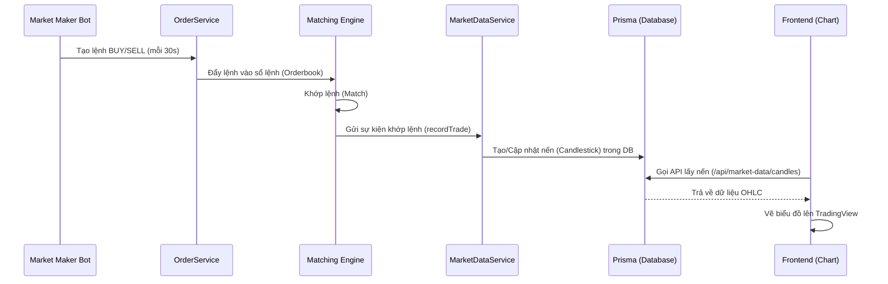

# Hướng dẫn Luồng Market Data & Kích hoạt Bot tạo Nến (Candlestick)

Dưới đây là tài liệu giải thích chi tiết về luồng hoạt động của dữ liệu thị trường (Market Data) từ Backend đến Frontend (biểu đồ) và cách kích hoạt **Market Maker Bot** để tự động tạo dữ liệu giao dịch cho biểu đồ TradingView.

---

## 1. Luồng Hoạt động của Market Data (Code Flow)

Luồng tạo dữ liệu nến (Candlestick) để hiển thị lên biểu đồ hoạt động theo các bước sau:



### Chi tiết các thành phần trong Backend:
1. **`MarketMakerService`** (`src/modules/market-maker/market-maker.service.ts`):
   - Đây là Bot chạy tự động bằng CronJob (`@Cron('*/30 * * * * *')`) mỗi 30 giây.
   - Bot sẽ tự động tạo các lệnh **BUY** và **SELL** (limit orders) dựa trên `referencePrice` của từng Asset đang active.
   - Các lệnh này được thiết kế để khớp với nhau.

2. **`OrderMatchingService`** (`src/modules/orders/services/order-matching.service.ts`):
   - Hệ thống khớp lệnh sẽ xử lý các lệnh từ Bot. Khi lệnh BUY và SELL khớp nhau, nó sẽ tạo ra một **Trade** (giao dịch).
   - Gọi hàm `this.marketDataService.recordTrade(trade)`.

3. **`MarketDataService`** (`src/modules/market-data/services/market-data.service.ts`):
   - Hàm `recordTrade()` sẽ tính toán và cập nhật vào bảng `Candlestick` trong Database.
   - Nó cập nhật các mức giá Open, High, Low, Close (OHLC) và Volume tương ứng với thời gian (1m, 5m, 1h, 1d...).

4. **Frontend Charting**:
   - TradingView trên Frontend sẽ gọi API `/api/market-data/candles`.
   - API này gọi về Endpoint `GET /market-data/candles` của Backend để lấy danh sách các điểm nến (CandlePoint) từ DB và render lên màn hình.

---

## 2. Cách Kích hoạt Market Maker Bot

Biểu đồ của bạn không hiển thị dữ liệu vì **chưa có giao dịch nào xảy ra**, do đó bảng `Candlestick` đang trống. Để có nến hiển thị, bạn cần kích hoạt Bot.

Tôi đã thay mặt bạn cấu hình kích hoạt Bot trong file `.env`. Dưới đây là những gì đã được thực hiện:

### Bước 1: Bật biến môi trường
Mở file `c:\rwa-backend\.env` và thêm biến môi trường sau (Tôi đã thêm giúp bạn):
```env
ENABLE_MARKET_MAKER=true
```
*(Bạn có thể kiểm tra dòng 43 trong file `.env` của backend).*

### Bước 2: Khởi động lại Backend
Vì biến môi trường vừa thay đổi, Backend cần được khởi động lại để đọc cấu hình mới. Bạn hãy chuyển sang terminal đang chạy Backend và làm như sau:

1. Nhấn `Ctrl + C` để tắt server đang chạy (`yarn start:dev`).
2. Chạy lại lệnh:
```bash
yarn start:dev
```

### Bước 3: Quan sát Terminal
Khi Bot được bật, bạn sẽ thấy các log của Market Maker cứ **mỗi 30 giây** trong terminal của Backend như sau:
```
[Market Maker] Placed Limit orders for <Symbol>: Bid <Price> | Ask <Price> | Volume <Quantity>
```

### Bước 4: Refresh Frontend
Đợi khoảng 1-2 phút để Bot tạo đủ một vài cây nến đầu tiên trong Database. Sau đó tải lại trang web (Frontend) của bạn, biểu đồ sẽ bắt đầu hiển thị các nến chạy realtime.

---

## 💡 Lưu ý (Troubleshooting)
- Đảm bảo trong Database đã có ít nhất một **Asset** với trạng thái `isActive = true` và có `referencePrice` để Bot lấy làm mốc tạo lệnh.
- Bạn có thể mở **Prisma Studio** (đang chạy ở port 5556) và kiểm tra bảng `Candlestick` hoặc bảng `Order` xem dữ liệu có đang được Bot liên tục đẩy vào hay không.
